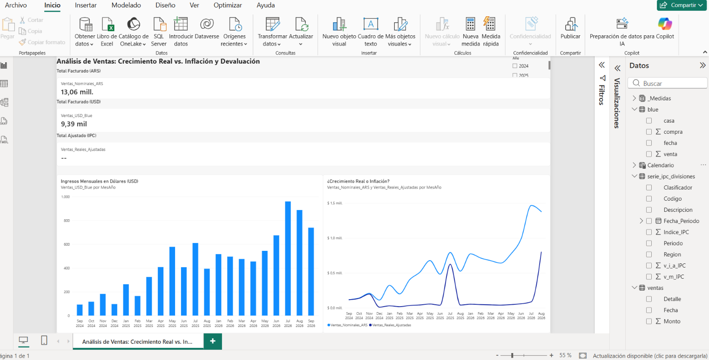
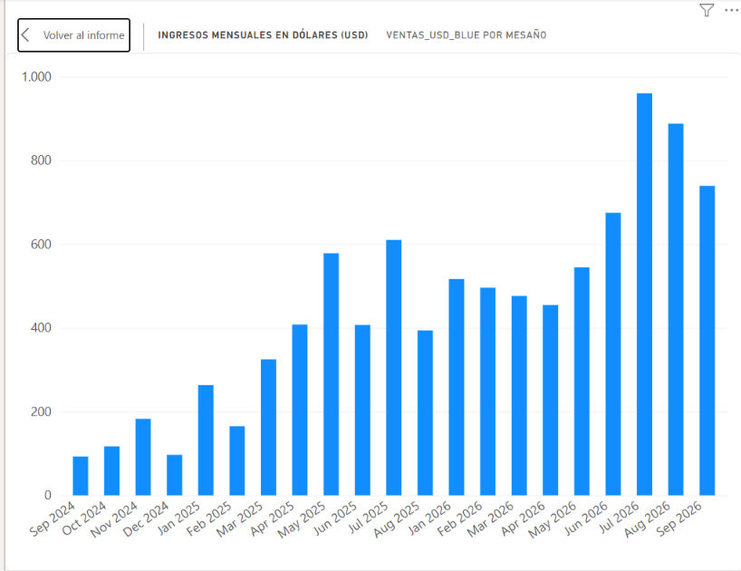
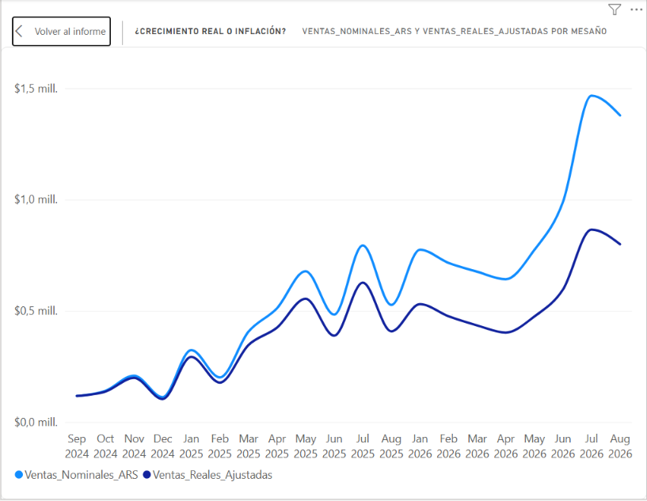
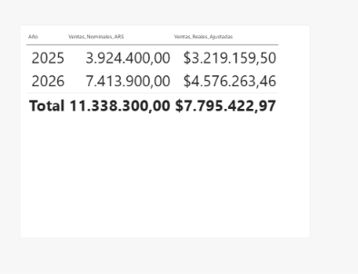

# 📊 Dashboard de análisis de ventas: crecimiento real vs. inflación (Power BI)

Dashboard interactivo en **Power BI** que transforma los registros de ventas e ingresos diarios de mi emprendimiento (clases particulares) en indicadores claros para tomar decisiones. Además compara la evolución de los ingresos con la **inflación (IPC)** y la **cotización del dólar blue** para responder una pregunta concreta: ¿los ingresos le ganaron a la inflación?

## 🎯 Objetivo

Pasar de anotaciones hechas a mano a un sistema de análisis que responda:

- ¿Cuánto vendo por período y cómo evoluciona el crecimiento?
- ¿Cuál es el ticket promedio y el margen de rentabilidad?
- ¿Mis ingresos acompañaron o superaron a la inflación?
- ¿Cómo evolucionan mis ingresos medidos en dólares?

## 🗂️ Fuentes de datos

| Archivo | Formato | Contenido |
|---|---|---|
| `Datos_Mi_Negocio.xlsx` | Excel | Registro de ventas e ingresos diarios (digitalizado desde papel) |
| `blue.json` | JSON | Cotización del dólar blue |
| `serie_ipc_divisiones.csv` | CSV | Serie del IPC por divisiones (base dic. 2016 = 100) |

## ⚙️ Proceso

1. **Digitalización:** pasé los registros manuales a Excel.
2. **ETL con Power Query:** extracción, limpieza y transformación de las tres fuentes (Excel, JSON y CSV), unificando formatos de fecha y de números.
3. **Modelo de datos:** relaciones entre ventas, calendario, cotización e IPC.
4. **Medidas en DAX:** KPIs, y ventas reales ajustadas por IPC (con `SUMX` para que el cálculo mensual también funcione en los totales).
5. **Visualización:** tablero interactivo con filtros por período.

## 📈 Visualizaciones

### Ingresos mensuales en dólares

### ¿Crecimiento real o inflación?
Ventas nominales vs. ventas reales (ajustadas por IPC, expresadas en pesos de septiembre de 2024).

### Comparación enero–agosto, 2025 vs. 2026

## 🔍 Principales hallazgos

- Comparando **enero–agosto de 2026 con el mismo período de 2025**, las ventas nominales en pesos crecieron **88,9%**, mientras que las ventas reales (ajustadas por IPC) crecieron **42,2%**: los ingresos **superaron a la inflación**.
- **Julio de 2026** fue el mes de mayores ingresos de la serie en dólares (cerca de USD 960).
- Las ventas reales terminan en agosto de 2026, el último mes con IPC en la serie utilizada.

## ⚠️ Limitaciones

- **Septiembre–diciembre de 2025 no tienen datos:** los registros físicos de esos meses se dañaron y no pudieron digitalizarse. Por eso se excluyen de las comparaciones y se comparan los mismos meses de cada año.
- Los totales nominales incluyen septiembre de 2026,
